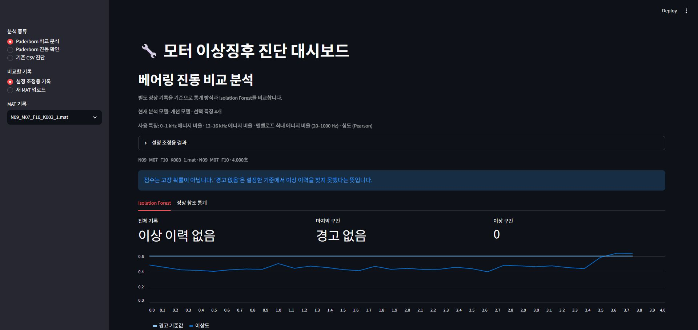
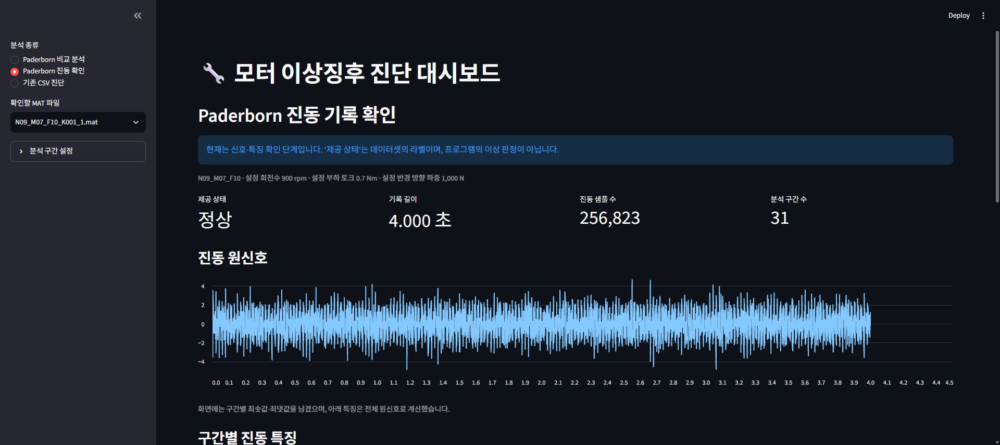
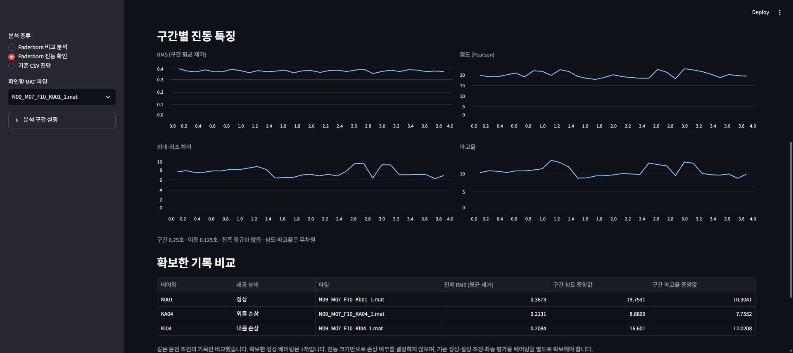
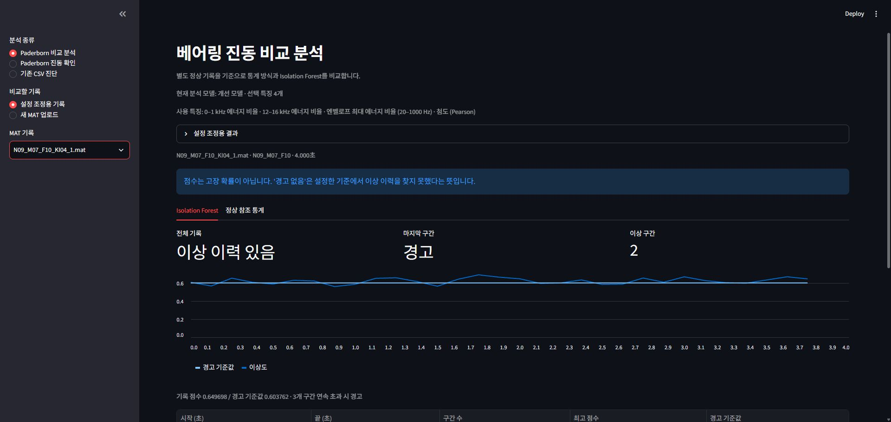
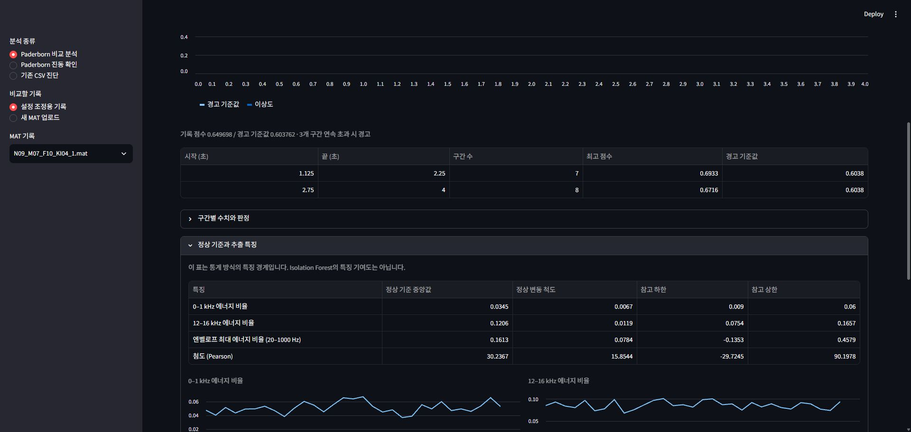
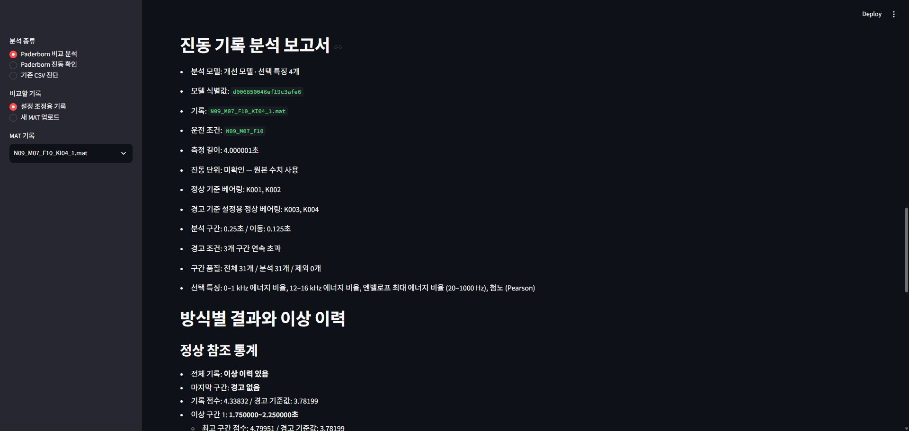
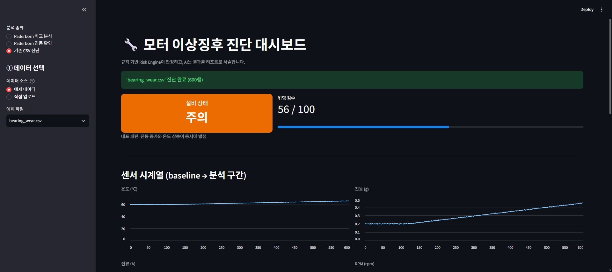

# 모터 이상징후 분석 시스템 구현 결과보고서 초안

본 초안은 기능 구현과 실제 실행 화면을 중심으로 작성하였다. 화면은 2026년 11월 8일
프로젝트의 Streamlit 대시보드를 실행하여 캡처하였다. 특징 선택 실험에서 선정한 네 특징의
개선 모델을 대시보드와 보고서에 연결한 상태를 기준으로 설명한다. 개발 지표와 최종 평가를 구분한다.

## 1. 개발 목적 및 구현 범위

본 프로젝트는 모터의 측정 기록을 분석하고, 이상이 발생한 시간 구간과 판단에 사용한
수치를 웹 대시보드에서 확인하며, 분석 결과를 점검 보고서로 작성하는 시스템을 구현하였다.
사용자가 측정 기록을 선택한 뒤 분석 결과와 근거를 확인하고 결과물을 저장하는 흐름을 구성하였다.

현재 주요 분석 대상은 Paderborn 베어링 데이터의 진동 기록이다. 검사할 기록과 별도로
확보한 정상 기록을 이용해 비교 기준을 생성하고, 전체 기록을 짧은 시간 구간으로 나누어
정상 참조 통계 방식과 Isolation Forest의 이상 탐지 결과를 각각 표시한다. 마지막 상태와
전체 이상 이력을 구분하여, 기록 중간에서 확인된 이상 정보가 유지되도록 구현하였다.

온도·진동·전류·RPM을 사용하는 기존 CSV 규칙 기반 진단 화면도 함께 제공한다.
이 기능은 Paderborn 진동 분석과 별도의 분석 방식으로 구성하였다. 현재 시스템은
저장된 측정 기록의 오프라인 분석을 대상으로 한다.

## 2. 시스템 구성 및 사용 기술


| 구성 요소 | 기술 및 구현 내용 |
|---|---|
| 웹 대시보드 | Streamlit을 이용한 분석 메뉴, 파일 선택, 그래프, 결과 표, 보고서 화면 |
| 데이터 처리 | Python, NumPy, Pandas를 이용한 신호·표 데이터 처리 |
| MAT 파일 입력 | SciPy를 이용한 Paderborn 측정 구조와 진동·시간축 읽기 |
| 정상 참조 통계 | 정상 특징의 중앙값과 MAD 기반 편차 계산 |
| 머신러닝 분석 | scikit-learn의 Isolation Forest를 정상 기록만으로 학습 |
| 설정·모델 관리 | YAML 분석 설정, joblib 모델 저장, 원본·모델 해시 확인 |
| 점검 보고서 | 분석 수치 기반 기본 템플릿과 선택적인 Claude API 문장 작성 기능 |
| 특징 선택 실험 | 별도 실행 스크립트와 Matplotlib 분포 그래프 |
| 개선 모델 연결 | 선택 모델과 경고 기준값을 재학습 없이 가져오고 개발 기록의 결과 일치를 확인한 뒤 활성화 |

정상 기준 생성과 모델 학습은 별도 명령으로 수행하며, 대시보드는 저장된 모델을 읽어
선택한 기록을 분석한다. 화면에서 파일을 선택할 때마다 모델을 다시 학습하지 않는다.

## 3. 주요 기능 구현 및 실행 화면

### 3.1 분석 메뉴 및 측정 기록 선택

대시보드의 왼쪽 사이드바에서 ‘Paderborn 비교 분석’, ‘Paderborn 진동 확인’, ‘기존 CSV 진단’
중 분석 기능을 선택하도록 구성하였다. 비교 분석에서는 준비된 개발용 MAT 기록을 선택하거나
같은 형식·운전 조건의 새 MAT 기록을 업로드하는 입력 방식을 제공한다.

비교 분석의 상단에는 선택한 기록명·운전 조건·측정 길이를 표시하고, 하단에는 방식별
전체 이상 이력, 마지막 구간 상태, 이상 구간 수와 점수 그래프를 배치하였다.
같은 브라우저 세션에서 다른 분석 메뉴나 업로드 화면을 다녀와도 이전 MAT 선택을 복원한다.
비교 분석과 진동 확인의 파일 선택은 각각 보관하여 서로 영향을 주지 않도록 하였다.



**그림 1. 분석 메뉴와 정상 기록의 비교 분석 화면.** K003의 1번 기록을 선택한 사례로,
기본 Isolation Forest 탭에서 이상 이력 없음·마지막 구간 경고 없음·이상 구간 0개를 표시한다.
이 표시는 해당 분석 기준의 결과이며 정상 상태를 보증하는 표현으로 사용하지 않는다.

### 3.2 진동 원신호 및 측정 정보 확인

‘Paderborn 진동 확인’ 화면에서는 원본 MAT의 진동 채널과 연결된 실제 시간축을 읽어
측정 기록을 표시한다. 기록 길이, 진동 샘플 수, 분석 구간 수와 데이터셋의 제공 상태를
함께 보여 주어 입력 자료의 기본 내용을 확인할 수 있도록 하였다.

원신호 그래프는 화면 표시 구간의 최솟값·최댓값을 남겨 데이터량을 줄이고, 특징 계산에는
전체 원신호를 사용한다. 데이터셋에서 제공한 정상·손상 상태와 프로그램의 예측을 구분하여 표시한다.



**그림 2. K001의 1번 진동 기록 확인 화면.** 약 4초의 신호, 256,823개 진동 샘플,
31개 분석 구간을 확인할 수 있다. 이 화면의 ‘제공 상태’는 데이터셋의 라벨이다.

### 3.3 시간 구간별 특징 계산 및 기록 비교

진동 신호를 기본 0.25초 구간으로 나누고 0.125초씩 이동하면서 평균 제거 RMS, Pearson 첨도,
최대·최소 차이, 파고율을 계산한다. 각 특징을 시간에 따른 그래프로 표시하여 신호의 변화
양상을 확인할 수 있도록 구현하였다. 원신호 확인 화면에서는 구간 길이와 이동 간격도 조정할 수 있다.

같은 운전 조건의 예시 기록을 비교하는 표와 구간 특징 CSV·파일 확인 정보 JSON 저장 버튼을
제공한다. 진동 단위가 비어 있는 자료는 원본 수치로 유지하고 단위 미확인 안내를 표시한다.



**그림 3. RMS·첨도·최대최소 차이·파고율 그래프 및 기록 비교표.** 이 원신호 확인 화면에는
프로젝트의 원본 확인용 예시 기록 3개를 표시한다. 정상 기준 학습·개발·최종 평가용으로
분리한 전체 200개 기록의 분석 화면과는 구분된다.

### 3.4 통계 및 머신러닝 방식의 이상 구간 분석

‘Paderborn 비교 분석’ 화면에서는 정상 참조 통계와 Isolation Forest 결과를 탭으로
구분하여 확인할 수 있다. 두 방식은 같은 시간 구간의 특징을 사용하며, 계산한 이상도와
각 방식의 ‘경고 기준값’을 그래프로 표시한다. 현재 네 특징은 0–1 kHz 에너지 비율,
12–16 kHz 에너지 비율, 엔벨로프 최대 에너지 비율, Pearson 첨도이다.
화면 상단에 현재 모델과 사용 특징을 표시하고 Isolation Forest 결과를 기본 탭으로 제공한다.

경고 기준값을 초과한 구간이 기본 3개 연속 나타나면 이상 이력으로 기록한다. 이상 구간의 시작·끝
시각, 구간 수, 최고 점수와 경고 기준값을 표로 제공한다. 전체 기록에서 발견한 이상 이력과
마지막 구간의 상태를 별도로 보관하고 표시하도록 구현하였다.
시간축·입력 품질로 제외한 구간은 화면과 보고서에서 안내하고, 빠진 구간 양쪽을 이어
연속 경고로 계산하지 않는다. 마지막 구간이 제외되면 ‘분석 제외’로 표시한다.



**그림 4. KI04의 1번 기록에 대한 개선 Isolation Forest 분석 화면.** 이 사례에서는 전체 이상
이력이 존재하며 마지막 구간에 경고가 표시되고, 합쳐진 이상 구간 수는 2개이다.

### 3.5 정상 기준과 분석 근거 확인

‘정상 기준과 추출 특징’ 영역에서는 통계 방식의 정상 특징 중앙값, 변동 척도, 비교 하한과
상한을 표로 제공한다. 구간별 특징 그래프와 데이터 품질 안내도 함께 표시한다.
사용자가 결과만 보는 데서 그치지 않고 어떤 수치와 기준을 비교했는지 확인하도록 구성하였다.



**그림 5. 이상 구간의 시간 정보와 통계 방식의 특징별 정상 기준.** 표의 특징 경계는 통계
방식의 설명 자료이며 Isolation Forest의 특징 중요도나 손상 원인 설명을 뜻하지 않는다.

### 3.6 점검 보고서 작성 및 결과 저장

‘보고서 작성’ 버튼을 누르면 선택한 기록의 운전 조건, 측정 길이, 정상 기준, 분석 설정,
방식별 이상 이력, 이상 구간과 측정값을 포함한 기본 점검 보고서를 작성한다.
보고서 저장과 분석 결과 JSON 저장 버튼을 제공하여 화면에서 확인한 내용을 결과물로
활용할 수 있도록 구현하였다.

기본 보고서는 외부 API 없이 작성한다. 생성형 AI 문장 작성은 별도 선택 기능으로
구성하였으며 분석 엔진이 산출한 근거를 설명하는 용도로 사용한다. 본 실행 화면에서는
기본 템플릿 보고서를 생성하였고 실제 생성형 AI API 호출은 수행하지 않았다.



**그림 6. KI04의 1번 기록을 개선 모델로 분석한 기본 보고서.** 두 방식 모두 전체 이상 이력이
확인된 사례로, 방식별 이상 구간과 마지막 상태를 각각 기술한다. 두 방식을 하나의 판정으로
임의 통합하지 않고 계산된 결과를 그대로 전달한다.

### 3.7 기존 CSV 기반 다중 센서 진단

기존 CSV 진단 화면에서는 온도·진동·전류·RPM 시계열을 입력받아 규칙 기반 위험 점수와
상태를 표시한다. 센서별 변화량과 조합 패턴을 이용하고 의심 원인, 권장 점검 항목,
점수 산출 근거를 제공한다. CSV 예제 선택과 직접 업로드 방식을 지원한다.

이 화면은 기록 초기 구간을 기준으로 사용하는 기존 규칙 기반 분석이며, 별도의 정상
기록으로 학습하는 Paderborn 비교 분석과 구분한다.



**그림 7. CSV 예제 bearing_wear.csv의 규칙 기반 진단 화면.** 기능 시연용 합성 예제
600행에서 위험 점수 56점과 ‘주의’ 상태를 표시한 사례이다. Paderborn 실측 데이터의
탐지 성능 결과로 취급하지 않는다.

## 4. 데이터 및 기능 검증 현황

Paderborn의 N09_M07_F10 조건에서 10개 베어링의 기록 200개를 준비하였다. 같은 베어링의
기록이 학습과 평가에 섞이지 않도록 정상 기준용 40개, 설정 조정용 80개, 최종 평가용
80개로 분리하였다. 최종 평가용 기록은 아직 평가하지 않았다.

자동 테스트 90개를 통과하였으며 입력 구조·시간축 검사, 구간 특징 계산, 정상만을 이용한
학습과 경계 설정, 중간 이상 이력 유지, 순간 초과 제외, 데이터 분리, 원본 변경 감지,
보고서 근거 전달, 특징 선택 절차 등을 확인하였다. 이 숫자는 테스트 항목 수이며 실제
손상 탐지 정확도를 의미하지 않는다.

실행 화면에서는 정상 기록 선택, 손상 기록의 Isolation Forest 분석, 정상 기준 표시,
진동 원신호·특징 그래프, 기본 점검 보고서 생성, 기존 CSV 진단을 확인하였다.
중간 이상 후 정상 복귀의 이력 유지 기능은 자동 시험으로 검증하였으며, 본문 화면이
해당 현상을 실제로 촬영한 사례인 것으로 설명하지 않는다.

특징 선택 실험에서 선정한 모델을 대시보드에 연결하고 개발 기록 80개를 실제 입력 경로로
다시 분석하였다. 실험과 점수·예측이 일치함을 확인하였으며, Isolation Forest의 정상
오경보는 1/40개, KA04 탐지는 20/20개, KI04 탐지는 18/20개였다. 이는 화면에 연결된 모델의
개발 결과이며 최종 평가 성능은 아니다. 특징 선택에 개발 손상 라벨을 참고했으나
모델 학습과 경고 기준값 설정에는 정상 기록만 사용하였다.

## 5. 구현 결과 및 향후 보완 사항

현재 시스템은 측정 기록 입력부터 특징 추출, 이상 구간 분석, 근거 시각화, 점검 보고서
작성까지 연결된 웹 대시보드를 구현하였다. 사용자는 분석 결과와 원본 신호, 특징값,
정상 비교 기준을 확인하고 보고서와 분석 결과를 저장하는 흐름을 사용할 수 있다.

향후에는 분석 설정을 확정한 후 보관한 기록으로 개선 모델의 최종 평가를 수행할 계획이다.
다른 장비의 입력 형식과 정상 기준을
등록하는 기능, 운전 조건별 설정, 실시간 수집 연동은 추가 개발 범위로 남아 있다.

Paderborn 실험 결과는 해당 측정 조건과 베어링 자료에 대한 결과이다. 새로운 장비의
진단 성능이나 실시간 보호 성능으로 확대해 해석하지 않는다.

## 6. 실행 방법 및 화면 자료

프로젝트 루트에서 준비된 모델로 대시보드를 실행한다.

```powershell
.\.venv\Scripts\python.exe -m streamlit run app.py
```

화면 이미지 원본은 이 문서와 같은 위치의 `screenshots` 폴더에 저장하였다.
문서와 screenshots 폴더를 함께 옮기면 같은 상대 경로로 화면 자료를 확인할 수 있다.

데이터 출처: Christian Lessmeier et al., KAt-DataCenter, Chair of Design and Drive Technology,
Paderborn University, [Bearing DataCenter](https://mb.uni-paderborn.de/en/kat/research/bearing-datacenter).

관련 코드: `app.py`, `modules/vibration_dashboard.py`, `modules/paderborn.py`,
`modules/vibration_selected_model.py`, `modules/vibration_deployment.py`,
`modules/vibration_report.py`, `modules/report_generator.py`.
